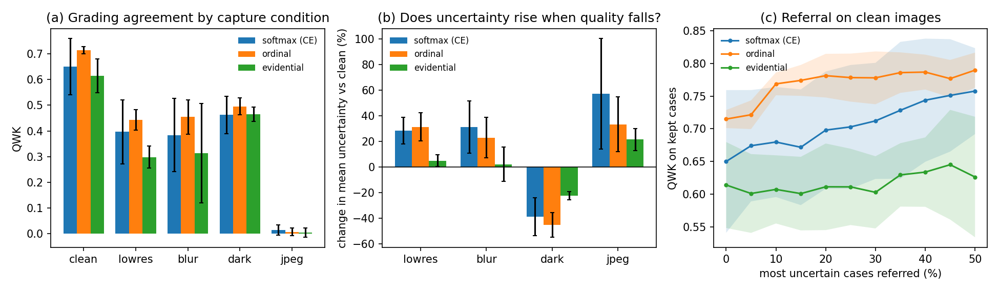

# Does a diabetic retinopathy grader know when the photo is bad?

This is a small study of three output heads for diabetic retinopathy (DR) grading on the public IDRiD dataset. It asks two questions:

- **Referral on good images:** can the model's uncertainty be used to refer cases to a human grader?
- **Poor capture:** does that uncertainty still behave sensibly when the photograph is poor, as it often is with low-cost or smartphone cameras?

## Data

Indian Diabetic Retinopathy Image Dataset (IDRiD; Porwal et al., 2018), released under CC BY 4.0. The data are not included here.

| Archive | Contents | SHA-256 |
|---|---|---|
| `B.Disease_Grading.zip` | 413 training and 103 test fundus images with DR grades 0–4 (official split) | `8a9f4752b35d74cc35ff48b21ad44f295a6f800110ec218fc2d1c264803e4d8c` |
| `A.Segmentation.zip` | 81 images with pixel masks for microaneurysms, haemorrhages, hard and soft exudates, and the optic disc | `f9a7fc0f7d228e326ca8ba61cfc99d54de689c52e44f52bde9917c78b07a1eaf` |

The grades are long-tailed:
- training set: [134, 20, 136, 74, 49] images for grades 0–4;
- test set: [34, 5, 32, 19, 13].

## Method

- **Pre-processing:** each image is cropped to the fundus disc and resized to 384 × 384 (`code/01_prep.py`).
- **Model:** a ResNet-18 pretrained on ImageNet.
- **Training:**
  - 15 epochs with a one-cycle learning-rate schedule;
  - augmentation: flips, 90° rotations, and brightness and contrast changes;
  - 15% of the training set is held out for model selection.
- **Heads compared (each trained with 3 seeds):**
  - **softmax (CE):** ordinary 5-class cross-entropy. Uncertainty = 1 − max probability.
  - **ordinal:** four cumulative thresholds, P(grade > k) for k = 0–3, so the model knows the grades are ordered. The thresholds are made monotone and turned into grade probabilities. Uncertainty = 1 − max probability.
  - **evidential:** Dirichlet evidence with the loss of Sensoy et al. (2018). Uncertainty = K / total evidence.
- **Simulated poor capture:** at test time only, the 103 test images are also degraded in four ways:
  - low resolution (¼ size, then upsampled);
  - Gaussian blur;
  - darkening with vignetting (gamma 1.8 and darker edges, like an undilated pupil or a poor flash);
  - heavy JPEG compression (quality 15).
- **Evaluation** (`code/03_eval.py`):
  - **grading:** quadratic weighted kappa (QWK) and accuracy;
  - **referable DR (grade ≥ 2):** AUC, sensitivity and specificity;
  - **calibration:** expected calibration error;
  - **referral:** results on the cases kept after referring the most uncertain 10–30%;
  - **statistics:** paired Wilcoxon tests on per-image absolute grade error.
- **Grad-CAM** (`code/04_gradcam.py`): measures how much of each model's attention falls on the annotated lesions, compared with what a random map would score.

## Results



On clean test images (mean over 3 seeds):

| Head | QWK | Referable AUC | Specificity | ECE |
|---|---|---|---|---|
| softmax (CE) | 0.650 ± 0.134 | 0.929 | 0.889 | 0.170 |
| ordinal | **0.715 ± 0.017** | **0.935** | **0.897** | **0.117** |
| evidential | 0.614 ± 0.080 | 0.855 | 0.615 | 0.171 |

**1. The ordinal head is the most accurate, stable and best calibrated.**
- It beats the evidential head on per-image grade error (Wilcoxon p = 0.034).
- Its difference from softmax is not significant (p = 0.207).
- Its QWK varies far less across seeds.

**2. Referral works on clean images.** Referring the 20% most uncertain cases raises the ordinal head's QWK on the remaining cases from 0.715 to 0.781, and accuracy from 0.631 to 0.711. The evidential head's uncertainty did not help here (0.614 → 0.611).

**3. Darkened images make the models more confident, not less.**
- With lower resolution, blur or JPEG compression, mean uncertainty rises as accuracy falls, which is what we want.
- With darkening, QWK drops but mean uncertainty **falls**, by 20–45%, in all nine runs.
- For the softmax head, the 95% bootstrap intervals (over test images) are −0.27 to −0.09 for the change in QWK and −0.12 to −0.05 for the change in uncertainty.
- A screener that trusts its own confidence would therefore refer fewer of exactly the images it gets wrong.

**4. The ordinal head looks at lesions.**
- Its Grad-CAM energy on annotated lesions is 1.6 times what a random map would score, and higher than random in 96% of the 81 images.
- It puts almost no attention on the optic disc (0.004 against 0.026 for random).
- The softmax and evidential heads score 1.2 times and 1.3 times random.

## Limitations

- **Small test set:** 103 test images, with only 5 of grade 1, and one camera (Kowa VX-10α). The numbers are early signals, not clinical evidence.
- **Simulated degradations:** these are not real smartphone photographs. JPEG quality 15 is too harsh; every head collapses, so a milder sweep is needed.
- **Grad-CAM check is not held-out:** some segmentation images may also be among the grading training images, so it shows where the model looks, not held-out accuracy.
- **Evidential head:**
  - It was not tuned beyond the defaults.
  - Its uncertainty is K / total evidence. In earlier work on spine MRI, this statistic ranked predictions worse than the Dirichlet mean, which may explain its flat referral curve here.

## Running

Python 3.10, CPU is enough (about 17–20 minutes per training run on a laptop CPU).

```bash
pip install -r requirements.txt
# unzip both IDRiD archives into data_raw/ so that it contains "A. Segmentation" and "B. Disease Grading"
python -I code/01_prep.py data_raw data 384
for s in 0 1 2; do for h in ce ordinal evidential; do
  python -I code/02_train.py data/grading.npz results/E1 --head $h --seed $s --epochs 15 --save_model $([ $s = 0 ] && echo 1 || echo 0)
done; done
python -I code/03_eval.py results/E1
python -I code/04_gradcam.py data/lesions.npz results/E1
python -I code/05_figure.py results/E1 results/fig_summary.png
```

The per-image test predictions of all nine runs are in `results/predictions/`. To reproduce the summary tables and the figure without training, run:

```bash
python -I code/03_eval.py results/predictions
python -I code/05_figure.py results/predictions results/fig_summary.png
```

## References

Porwal, P. et al. (2018) 'Indian Diabetic Retinopathy Image Dataset (IDRiD): a database for diabetic retinopathy screening research', *Data*, 3(3), 25.

Sensoy, M., Kaplan, L. and Kandemir, M. (2018) 'Evidential deep learning to quantify classification uncertainty', *Advances in Neural Information Processing Systems*, 31.
